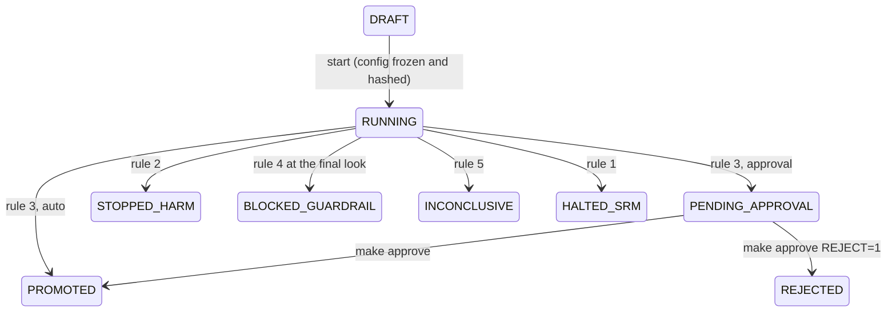

# Slow & Steady

**VANI prompt A/B testing, auto-rollout and the audit-and-fix loop.** By Team Hare & Tortoise.

The hare ships a prompt change on a hunch and finds out later. The tortoise ships it on evidence.

Today a change to the VANI voice-bot prompt goes live to every caller on judgement alone. If the
change is bad, it costs meetings until someone notices. If it is good, nobody can prove it.

This platform makes prompt changes ship on evidence instead:

1. A new prompt (variant B) gets a fixed share of leads, 10% by default. The other 90% keep the
   current prompt (A).
2. The platform tracks the business goal, **Meeting Fixed per answered lead**, and a guardrail,
   **call duration**.
3. It looks at the data as it arrives. It stops B as soon as B is clearly costing meetings, and
   promotes B (automatically, or after a named approver signs off) as soon as B is proven better.
   When the evidence is too thin either way, it says so and keeps A.
4. Every look and every decision is logged with a plain-English reason and what the decision is
   worth per week, for example "B now gets 100% of traffic, worth ≈ +N Meeting Fixed a week".

**What is at stake.** The headline experiment sees about 885 answered sellers a day (about 6,200 a
week) at a baseline of 0.1795 Meeting Fixed per answered lead. The smallest change it is sized to
detect, +15% relative, is worth **≈ 167 extra Meeting Fixed a week** at full rollout. A prompt that
loses 30% of meetings at full rollout would cost about 330 a week, so it should be stopped fast.

There is no live traffic. Outcomes come from replaying the real historical call data with a known
effect injected into B. The engine never sees that effect, so every decision can be checked against
ground truth (see [How outcomes are simulated](#how-outcomes-are-simulated) and
[Limitations](#limitations)).

Contents: [Quick start](#quick-start) · [Setup](#setup) · [Make targets](#make-targets) ·
[Repo layout](#repo-layout) · [Unit, trigger and maturation](#unit-trigger-and-maturation) ·
[Traffic split and SRM](#traffic-split-and-srm-evidence) · [Sequential method](#sequential-method) ·
[Why this method](#why-this-method) · [Decision rules](#decision-rules-and-state-machine) ·
[Decision log](#decision-log) · [Simulation](#how-outcomes-are-simulated) ·
[Scenarios](#scenarios) · [Validation](#validation) · [Dashboard and slide](#dashboard-and-slide) ·
[Limitations](#limitations) · [The loop: where prompt B comes from](#the-loop-where-prompt-b-comes-from)

## The loop: where prompt B comes from

The A/B engine above decides whether a new prompt is better. The loop (`src/abtest/ext/`)
writes that new prompt from the calls themselves, then feeds it to the engine, and repeats:

1. **Listen.** Call recordings become bot / buyer transcripts (Gemini 3 Flash through OpenRouter).
2. **Judge.** Every call is graded Pass / Non-Fatal / Fatal on IndiaMART's own QA checklist (18
   rubrics, one per column of the human audit sheet) plus 3 prompt rules, with a reason and the quote
   behind each grade. Agreement with the human auditors is measured on calls they graded.
3. **Improve.** Failures become named root causes, ranked by
   `priority = 100 × (3·fatal + non-fatal) / (3·audited)`. The top prompt-fixable cause gets 1–3
   minimal edits to the prompt (Claude Opus 5.5).
4. **Gate and replay.** A safety check blocks edits that add promises or weaken honesty rules; then
   the same buyers are simulated against Prompt A and Prompt B for a fair before/after.
5. **Prove and roll out.** Prompt B goes to 10% through the engine above (simulated traffic, with the
   assumed effect stated). A person approves, B becomes production, and the next cycle audits B.

```bash
make platform                    # the platform: http://127.0.0.1:8600 (demo data if nothing has run)
make listen SOURCE=production ARGS=--yes-send-real-audio        # recordings -> transcripts
make judge SOURCE=audited ARGS=--yes-send-real-transcripts       # grade the human-audited calls
make agreement                   # judge vs IndiaMART's auditors -> reports/judge_agreement.md
make loop ARGS=--yes-send-real-transcripts   # one cycle: judge, root causes, fix, gate, replay, A/B
make loop-status                 # the prompt registry, the cycles and the next action
```

The loop fixes the buyer-side prompt, so it runs on the buyer-side calls IndiaMART's QA team
audited (`LOOP_CORPUS=audited`, the default). The 250-call production sample is the seller-side
Vani; `LOOP_CORPUS=production` runs the loop on it instead.

The `--yes-send-real-*` flags send real customer calls to the model provider; nothing goes out
without them. Replays built from real calls count as real too. The platform's buttons send real call
content only when it was started with `LOOP_ALLOW_REAL=1 make platform`. Loop artifacts (recordings, transcripts, audits, prompt versions) live under
`data/derived/loop/`, git-ignored like the rest of `data/`. The API is in
[docs/loop_api.md](docs/loop_api.md); the build journey is in [skills.md](skills.md).

## Quick start

```bash
ln -s /path/to/organiser/drive/folder data   # the provided files; see Setup
make setup                       # uv sync (Python 3.12)
make demo                        # win, harm, inconclusive, then the approval gate
make dashboard                   # http://localhost:8501
```

`make demo` runs the three required scenarios end to end (B wins and is promoted, B is worse and is
stopped early, inconclusive), writes a split report for each, then runs the approval scenario and
approves it as `ACTOR` (default `$USER`; one word, no spaces, e.g. `make demo ACTOR=kartik`). It
takes under a minute. A 3-minute presenter walkthrough is in
[docs/demo_script.md](docs/demo_script.md).

The approval scenario runs on the win scenario's traffic (`seed: 1101`). The same experiment is
gated by a human instead of being auto-promoted: it reaches PENDING_APPROVAL at look 4, and
`make approve` promotes it.

## Setup

**Tools.** [uv](https://docs.astral.sh/uv/) and Python 3.12 (`.python-version`;
`pyproject.toml` allows 3.11+). `make setup` runs `uv sync`, which creates `.venv` from `uv.lock`.

**Data.** The source files come from the organisers' shared Drive folder. Put them in `data/` at
the repo root, as a folder or a symlink. `data/` is gitignored. The provided files are
**read-only**: nothing in this repo writes to them, and no row of them may be committed. The Vani
Loop writes its own artifacts under `data/derived/loop/`.

| File | Used for |
|---|---|
| `Best-Time-to-Call - Call Attempts Apr-Sep 2026.csv` (75 MB) | Dataset A, `bttc`: the headline experiment (Meeting Fixed and call duration) |
| `Call_Logs_Hackathon.csv` (1,000 rows) | Dataset B, `buyer_logs`: the buyer-side experiment |
| `Sarvam Prompt - Buyer Side VANI.docx` | The base prompt, extracted to `prompts/base_buyer_vani.txt` |
| `Best-Time-to-Call - Sellers.csv` (40 MB) | Optional seller attributes; not used yet |
| `Best-Time-to-Call - Data Dictionary.md` | Column reference for Dataset A |
| `Current Definitions of Call Quality Matrix being used in VANI.png` | Reference only; the data has no per-call QA labels |

`prompts/base_buyer_vani.txt` is committed. `make setup` re-extracts it from the `.docx` with
python-docx only if it is missing. It goes through python-docx, not a Markdown export, because a
Markdown export escapes `_` and `!` and corrupts the prompt's Jinja blocks. That re-extraction
reads `data/Sarvam Prompt - Buyer Side VANI.docx` only; `ABTEST_DATA_DIR` is not used there.

**Environment variables.**

| Variable | Default | Meaning |
|---|---|---|
| `ABTEST_DATA_DIR` | `data/` in the repo root | Where the profile, simulator and validation read the source files (not `make setup`) |
| `ABTEST_DB` | `abtest.db` in the repo root | The SQLite experiment store (gitignored) |

Tests: `make test` runs everything, including the tests marked `data`, which need the real files.
CI has no `data/`, so it runs `uv run pytest -m "not data"`.

## Make targets

Parameters are passed as `NAME=value`. Defaults are in brackets.

| Target | Parameters | What it does |
|---|---|---|
| `setup` | | `uv sync`; re-extract the base prompt if it is missing |
| `test` | | The full pytest suite |
| `profile` | `DATASET=bttc\|buyer_logs` [bttc] | Data profile: volumes, answer rate, baseline p, durations, follow-up lag → `reports/data_profile_<dataset>.md` |
| `preflight` | `EXP=<experiment yaml>` [the DATASET's experiment] | Fixed-design n_B, inflation factor R, n_B,max, days needed against the window, smallest detectable lift; flags UNDERPOWERED |
| `boundaries` | `EXP=<experiment yaml>` [the DATASET's experiment] | Win and harm boundaries for 5 and 7 equal looks, the gsDesign reference check, a 10⁶-path Monte Carlo cross-check, and the planned schedule with R |
| `validate` | `EXP=<experiment yaml>` [the DATASET's experiment] | 2,000 A/A and 2,000 power runs on the engine's own code → `reports/validation.md` and PNG charts; exits non-zero if a §4 target is missed |
| `simulate` | `SCENARIO=<name>` [win] | Runs one scenario in batch into the store: each look, the arms, the final state, the weekly business impact; writes `reports/sim_truth_<scenario>.md` |
| `live` | `SCENARIO=<name>` [win], `SPEED=<s>` [1] | The same run, paced at SPEED wall-clock seconds per simulated day, to watch on the dashboard |
| `scenarios` | `SEEDS=<n>` [20] | Every scenario at seeds 1..n (in memory), then each pinned demo seed into the store → `reports/scenarios.md` |
| `split-report` | `SCENARIO=<name>` [win] | Configured vs achieved split, SRM, per-day split, leads in both arms, re-hash check → `reports/split_<scenario>.md` and `.png` |
| `approve` | `EXP=<experiment id>` [vani-meeting-v1-approval], `ACTOR=<name>` [$USER], `REJECT=1` | Moves a PENDING_APPROVAL experiment to PROMOTED (or REJECTED with `REJECT=1`) and logs the actor |
| `api` | `PORT=<port>` [8000] | FastAPI router: `GET /assign?experiment_id=&lead_id=` |
| `dashboard` | | Streamlit dashboard on http://localhost:8501 |
| `slide` | | `slide/one_slide.pptx` and its chart PNG in `reports/`, built from the store |
| `demo` | `ACTOR=<name>` [$USER] | `simulate` + `split-report` for win, harm and inconclusive, then `simulate SCENARIO=approval` and `approve` |

`EXP` means a YAML path for `preflight`, `boundaries` and `validate`
(`configs/experiments/vani-meeting-v1.yaml` or `configs/experiments/vani-buyer-qty-asks-v1.yaml`;
the default follows `DATASET`, which defaults to `bttc`), and an experiment id for `approve`. A
scenario run's experiment id is `<experiment id>-<scenario>`, for example
`vani-meeting-v1-approval`.

`ACTOR` must be one word with no spaces, for example
`make approve EXP=vani-meeting-v1-approval ACTOR=kartik`. The Makefile passes it unquoted, so
`ACTOR="Kartik Sehgal"` fails with "unrecognized arguments: Sehgal".

Scenario names: `win`, `harm`, `inconclusive`, `guardrail_block`, `srm_fault`, `approval`,
`buyer_disconnect_stop` (see [Scenarios](#scenarios)).

## Repo layout

```
Makefile  pyproject.toml  uv.lock  README.md  PLAN.md  TEAM.md (team workflow and file ownership)
.github/workflows/ci.yml           CI: uv sync --locked, pytest -m "not data"
.streamlit/config.toml             dashboard theme (IndiaMART colours)
configs/
  experiments/       the only configs the engine reads
    vani-meeting-v1.yaml           headline: bttc, Meeting Fixed, duration guardrail
    vani-buyer-qty-asks-v1.yaml    buyer side: BL success, abrupt-disconnect guardrail
  sims/              simulator ground truth per scenario; the engine never reads these
  scenarios/         one file per scenario: {experiment, sim, seed, overrides}
prompts/base_buyer_vani.txt        base prompt, extracted from the provided .docx
src/abtest/
  contracts.py       pydantic models and the module signatures every module codes against
  store.py           SQLite schema (WAL) and helpers
  config.py          load, validate and freeze configs; resolve and hash variant prompts
  data.py            one adapter per dataset -> canonical call schema
  profile.py         data profile report
  power.py           pre-flight sample size, inflation factor R, days needed
  router.py          hash bucketing on the live allocation, exposure log
  api.py             FastAPI GET /assign
  simulator.py       cluster-bootstrap replay, effect and fault injection, truth report
  srm.py             sample-ratio-mismatch test and split report
  boundaries.py      alpha-spending boundaries, exact crossing probabilities, Monte Carlo check
  metrics.py         per-lead outcomes with trigger and maturation
  analysis.py        z-statistics, CIs, guardrail repeated CIs -> LookResult
  rules.py           evaluate_look: the decision rules as one pure function
  decision.py        state machine, live allocation, approval, decision log
  runner.py          sim clock, look scheduling, analysis -> rules -> decision loop, sweeps
  validation.py      A/A, power and naive-peeking proof pack
dashboard/
  app.py             Streamlit dashboard: experiments list and experiment detail
  common.py          shared store reads, business-impact text, colours and HTML helpers
  pages/0_Validation.py  the Validation page, from reports/validation.md
slide/build_slide.py the one-slide summary
docs/demo_script.md  3-minute demo walkthrough
tests/               pytest; tests marked `data` need data/
reports/             generated reports and PNGs
logs/decisions.jsonl decision log mirror (generated, gitignored)
data/                the provided files (gitignored, read-only)
```

## Unit, trigger and maturation

- **Unit.** The lead (seller GLID in `bttc`, buyer GLID in `buyer_logs`) is both the randomisation
  unit and the analysis unit. Statistics are never computed over calls: calls of one lead are
  correlated and always share a variant, so counting calls overstates the sample size and produces
  false wins.
- **Trigger.** A lead is assigned at its first dial but enters the analysis only at its **first
  answered call**, the first moment it hears the bot. Unanswered leads heard neither prompt, so
  counting them adds noise and no information. This is valid because the pickup happens before the
  prompt says anything, so the variant cannot influence it. A later pickup never triggers, because
  whether someone answers a second call can depend on how the first one went. SRM is checked on both
  assigned and triggered leads.
- **Primary, per lead.** 1 if any answered call in the window has a disposition in the configured
  set (`Meeting Fixed`; for the buyer experiment `BL Enriched` or `BL Approved`), else 0. Any set
  of dispositions can be the goal, by config.
- **Secondary, per lead.** Continuous (`answered_duration_s`): the mean duration over the lead's
  answered calls; unanswered calls have no talk time and would turn the metric into answer rate.
  Binary (`abrupt_disconnect`): the same rule as the primary.
- **Maturation.** A lead counts at a look only once `first answered call + maturation_days ≤ look
  time` (2 days for `bttc`, 1 day for `buyer_logs`, from the follow-up lag in the data profiles).
  Without this, leads whose follow-up calls have not happened yet count as failures.

## Traffic split and SRM evidence

- **Bucketing.** `bucket = int(sha256(f"{salt}:{lead_id}").hexdigest()[:15], 16) % 10000`. A lead
  gets B if `bucket / 10000 < share_B`, else A. Each experiment has its own salt, so assignments
  are independent across experiments.
- **Stickiness without state.** While the experiment is RUNNING, the variant is a pure function of
  (salt, lead_id, configured allocation). The same lead gets the same variant on every call, in
  every process, with nothing stored. Tests check stickiness, cross-process determinism, bucket
  uniformity and salt independence.
- **Live allocation.** The router always reads the live allocation in `experiment_state`. DRAFT
  sends everyone to A; RUNNING and PENDING_APPROVAL use the configured split; PROMOTED sends 100%
  to B; every other end state sends 100% back to A.
- **Exposure log.** Every assignment is logged as `experiment_id, lead_id, variant, bucket, ts`.
  `GET /assign` returns `{variant, state, config_hash, prompt_hash}`.
- **SRM check at every look.** A 1-df chi-square test of the assigned-lead counts, and separately
  of the triggered-lead counts, against the configured share. p < `srm_p_threshold` (0.001) on
  either halts the experiment (rule 1).
- **Split report** (`make split-report SCENARIO=<name>`): configured vs achieved share of B with a
  Wilson 95% CI, the SRM χ² and p on assigned and on triggered leads, the per-day split, the count
  of leads in both arms (must be 0), and a re-hash check that recomputes every logged bucket and
  variant from the salt (must PASS). It writes `reports/split_<scenario>.md` and a PNG. The
  `srm_fault` scenario drops 15% of B exposures before they are logged, and the check catches it.

## Sequential method

The engine looks at the data repeatedly, so it uses a group-sequential design: each look has a win
boundary and a harm boundary on the z scale, and the boundaries are set so the error rates hold
over all the looks together.

- **Primary statistic.** Two-proportion z, pooled SE for z, unpooled SE for the 95% CI on the lift.
- **Guardrail statistic.** Continuous: relative change in means `Δ = (μB − μA)/μA` with a
  delta-method SE. Binary: absolute difference `Δ = pB − pA` with the unpooled SE.
- **Information fraction.** At look k, `t_k = n_B,k / n_B,max`, counting matured triggered B leads.
- **Spending functions** (one-sided). Win, Lan-DeMets O'Brien-Fleming type:
  `α_w(t) = 2·(1 − Φ(z_{1−α_win/2} / √t))` with α_win = 0.025. Harm, Pocock type:
  `α_h(t) = α_harm · ln(1 + (e − 1)·t)` with α_harm = 0.05.
- **Boundaries at the observed fractions.** The runner looks after any simulated day on which t
  reaches the next point of the 1/K grid (first look at t ≥ `min_info_first_look` = 0.20; final
  look at t ≥ 1 or on the last day of the window). Boundaries are recomputed at the fractions
  actually observed, which keeps unequal or unplanned looks valid. Spending uses min(t, 1), so a
  final look that overshoots t = 1 never spends more than α.
- **Non-binding.** Each boundary is computed ignoring the other, so both error rates stay at or
  below nominal.
- **Exact computation.** Crossing probabilities come from the Armitage-McPherson-Rowe recursion
  (numerical integration on a grid, Jennison & Turnbull 2000, ch. 19). Monte Carlo with 10⁶ paths
  is only a cross-check, because it cannot pin down an early win boundary near z ≈ 4.9.
- **Reference check.** For 5 equally spaced looks at α = 0.025 the win boundaries are 4.877,
  3.357, 2.680, 2.290 and 2.031, matching gsDesign `sfLDOF` to within 0.001 (`make boundaries`).
- **Guardrail at look k.** The repeated confidence interval `Δ̂ ± c_k·SE`, where c_k is the win
  boundary at look k. It is valid however many times we look, and it is wide early on, so the
  guardrail cannot clear on a handful of leads.
- **Maximum sample size.** A fixed-design one-sided two-proportion power calculation (allocation,
  baseline p, MDE, α_win, power 0.80), multiplied by an inflation factor R computed from the
  boundaries: find the drift θ at which the win boundaries at the planned schedule are crossed by
  the last look with probability 0.80, then `R = (θ / (z_{1−α} + z_{1−β}))²`. R is never
  hard-coded. For the headline experiment (7 planned looks at t = 0.20 … 1.00): fixed-design
  n_B = 1,840, **R ≈ 1.033, n_B,max ≈ 1,900** matured triggered B leads, about 19,000 matured
  triggered leads in all, which takes 23.5 days of the 28-day window at historical volume
  (`make preflight`).

The planned boundaries for the headline experiment (`make boundaries`):

| look | 1 | 2 | 3 | 4 | 5 | 6 | 7 |
|---|---|---|---|---|---|---|---|
| t | 0.200 | 0.333 | 0.467 | 0.600 | 0.733 | 0.867 | 1.000 |
| win: promote if z ≥ | 4.877 | 3.711 | 3.090 | 2.699 | 2.426 | 2.221 | 2.061 |
| harm: stop if z ≤ | −2.176 | −2.229 | −2.203 | −2.178 | −2.157 | −2.139 | −2.123 |

## Why this method

- **Alpha spending caps the false-win rate at 2.5%, however many looks we take.** Each look may
  only spend the part of α_win that the spending function allows by its information fraction, and
  the total never exceeds 2.5% one-sided. Checking a plain z ≥ 1.96 at every look instead
  ("peeking") lets the false-win rate climb with every extra look; `make validate` measures both on
  the same runs (see [Validation](#validation)). To see the size of the peeking effect, compare the
  A/A "primary-only win crossing" rows in `reports/validation.md`. The "false win" rows understate
  it, because the guardrail RCI uses the sequential c_k on the naive path too.
- **O'Brien-Fleming-type win boundaries make early wins nearly impossible**, so a lucky streak
  cannot trigger a promotion. At the first look (t = 0.20) B needs z ≥ 4.877; the chance of that
  with no real effect is about 5 in 10 million. The boundary relaxes to ≈ 2.06 by the last look,
  close to the fixed-design 1.96, which is why the sequential design costs only ≈ 3% more sample
  than a single fixed test (R ≈ 1.033).
- **The Pocock-type harm boundary stops bad variants fast, because harm costs real meetings.** It
  spends α_harm almost evenly (about 30% of it at the first look), so the harm boundary sits near
  z ≈ −2.2 at every look and a clearly worse B is stopped at the first look that shows it. A false
  harm stop only delays a good prompt (A, the status quo, stays), so harm gets the looser α of 5%.
- **Rejected: Bayesian testing with a fixed P(B > A) threshold.** "Promote when P(B > A) > 95%",
  checked after every batch, is peeking under another name: under repeated checks the false-win
  rate inflates well above what the threshold suggests, and nothing caps it.
- **Rejected: mSPRT (always-valid p-values).** It needs a mixing-variance parameter that sets
  which effect sizes it is powerful for, and that is hard to justify without prior experiments. We
  also have a fixed window and a planned maximum sample, which is exactly the case group-sequential
  boundaries are built for.

## Decision rules and state machine

Rules are evaluated in order at every look; the first one that matches decides. For the guardrail
the direction follows `worse_if` (duration and abrupt disconnects are worse if they increase).

| # | Condition | Outcome | Traffic afterwards |
|---|---|---|---|
| 1 | SRM p < 0.001 on assigned or triggered leads | **HALTED_SRM**: results untrusted, nothing else is evaluated | A 100% |
| 2 | z ≤ −h_k, or the guardrail RCI lies entirely beyond the margin | **STOPPED_HARM** | A 100% |
| 3 | z ≥ w_k and the guardrail RCI lies entirely within the margin | **PROMOTED** (`promotion: auto`) or **PENDING_APPROVAL** (`promotion: approval`) | B 100%, or the tested split until someone decides |
| 4 | z ≥ w_k but the guardrail is not cleared | CONTINUE; at the final look **BLOCKED_GUARDRAIL** | the tested split, then A 100% |
| 5 | Final look and nothing crossed | **INCONCLUSIVE**, with the lift CI and the lift this sample could have detected | A 100% |

The primary decides; the guardrail can only veto. A secondary configured as a reported goal
(`role: goal`) is shown with its CI but never gates a decision. Margins: duration +10% relative
(`margin_rel: 0.10`); abrupt disconnects +2 pp (`margin_abs: 0.02`).



- DRAFT → RUNNING freezes the config: the store keeps the canonical JSON, `config_hash` (SHA-256
  of it) and `prompt_hash` (SHA-256 of each resolved prompt). A SQLite trigger refuses any later
  change to the frozen config.
- Terminal states (PROMOTED, REJECTED, STOPPED_HARM, BLOCKED_GUARDRAIL, INCONCLUSIVE, HALTED_SRM)
  are immutable, also enforced by a trigger.
- The headline config defaults to `promotion: approval`. The `win` scenario overrides it to `auto`
  to show auto-promotion; the `approval` scenario keeps the approval gate.

## Decision log

Append-only, written to the `decisions` table of the store and mirrored to `logs/decisions.jsonl`:
one row per look (including CONTINUE) and one row per state change. Each row carries

```
ts_wall, ts_sim, experiment_id, config_hash, prompt_hash_A, prompt_hash_B, kind, look,
info_fraction, n_A, n_B,
primary:   {rate_A, rate_B, lift_abs, lift_rel, ci95, z, win_boundary, harm_boundary},
guardrail: {mean_A, mean_B, rel_change, delta, rci, margin},
srm:       {configured_share_B, observed_share_B, p, observed_share_B_triggered, p_triggered},
decision, reason, actor, from_state, to_state
```

- `reason` is a readable sentence: the rule that fired with its numbers, plus, on a state change,
  what the change is worth per week at full rollout. For example: "Harm boundary crossed at look 2
  (z = −2.90 ≤ −2.27); traffic returned to A. All traffic back to A; at full rollout B would have
  cost ≈ N Meeting Fixed a week."
- `actor` is `engine`, or the approver's name for an approval or rejection.
- The weekly figure is the engine's estimate: the observed absolute lift times the matured
  triggered leads per day across both arms, times 7. It is an estimate from the experiment's own
  data, not the simulator's truth.
- A trigger makes the table append-only. Rerunning a scenario replaces that experiment's rows in
  the store; `logs/decisions.jsonl` keeps every run.

## How outcomes are simulated

There is no live traffic, so each scenario replays the historical calls with a known effect
injected into B (`simulator.py`, PLAN §2.5).

- **Canonical schema.** Each dataset adapter maps its file to `call_id, lead_id, ts, answered,
  disposition, duration_s, attempt_no, bot_version`. Fields a dataset lacks are null.
- **Cluster bootstrap of lead-windows.** The bootstrap unit is a lead-window: one historical lead's
  calls inside one non-overlapping window-length block of the reference period (28 days for
  `bttc`), with their timing relative to that lead's first call in the block. Each simulated day
  draws `daily_leads × scale` lead-windows with replacement, keeps all their calls and their
  relative timing, renames each `sim-<seed>-<n>`, and routes it through the real `router.py`.
  Simulated time starts the day after the reference data ends; calls after the window are not
  generated.
- **Arm A** keeps the historical outcome unchanged.
- **Arm B, primary effect** (relative lift L, injected only into triggered leads, because a lead
  that never answers heard neither prompt). If L > 0, each non-success lead becomes a success with
  probability `q = p·L/(1−p)`: its last answered call becomes `Meeting Fixed`, with a duration
  resampled from historical Meeting Fixed calls. This moves B's rate from p to p(1 + L). If L < 0,
  each success lead loses its success with probability |L|, and its success call gets a disposition
  and duration resampled from answered non-success calls.
- **Arm B, secondary effect.** Continuous: every answered B call's duration is scaled so that B's
  **total** true change equals `secondary_change`, net of what the extra meeting calls alone
  already add. Binary: after the primary injection, untouched triggered B leads move into the
  secondary disposition set until the per-lead rate rises by `secondary_change` (absolute).
- **Fault injection.** `drop_b_exposure_rate` of B exposure events are dropped before they are
  logged. Those leads still make calls, so the engine sees fewer B leads than the router assigned,
  which the SRM check must catch.
- **Clock.** `make simulate` runs as fast as possible; `make live SPEED=s` sleeps s seconds per
  simulated day. The runner writes each simulated day's exposures and calls to the store and, at a
  look, reads back only exposures and calls timestamped up to the look.
- **Truth report.** The simulator knows the counterfactual for every B lead, so it reports the
  injected and the realised lift and secondary change, and their weekly business value, in
  `reports/sim_truth_<scenario>.md` and the `sim_truth` table.
- **The engine never sees the truth.** The engine (`metrics`, `analysis`, `boundaries`, `rules`,
  `decision`) takes only exposures, calls, their aggregates and the experiment config. Nothing under
  `configs/sims/` and nothing from the `sim_truth` table is read on the engine path.
  `tests/test_engine_isolation.py` checks this statically (imports and names), by signature, and at
  runtime (a full engine pass with every read of `configs/sims/` made to fail). The dashboard shows
  the truth only in a collapsed "Ground truth (engine never sees this)" panel, next to the engine's
  estimate.

## Scenarios

All on the headline experiment except the last. Each scenario has a pinned demo seed in
`configs/scenarios/<name>.yaml`.

| Scenario | Injected effect in B | Expected outcome |
|---|---|---|
| `win` | Meeting Fixed +25% relative (≈ 1.7× the MDE), duration +3%; `promotion: auto` | PROMOTED |
| `harm` | Meeting Fixed −30% | STOPPED_HARM by look 3 |
| `inconclusive` | Meeting Fixed +3%, well below the 15% MDE | INCONCLUSIVE at the final look |
| `guardrail_block` | Meeting Fixed +30%, duration +10% (equal to the margin) | BLOCKED_GUARDRAIL |
| `srm_fault` | No effect; 15% of B exposures dropped before logging | HALTED_SRM |
| `approval` | The win effect with `promotion: approval` | PENDING_APPROVAL, then PROMOTED after `make approve` (the pinned seed currently misses: see below) |
| `buyer_disconnect_stop` | Buyer experiment: BL success +10%, abrupt disconnects +9 pp; volume ×4 | STOPPED_HARM via the binary guardrail |

`make scenarios` runs every scenario at seeds 1..20 and reports the terminal state, stop look, lift
estimate with its CI, guardrail Δ with its RCI, weekly impact, and the hit rate over the 20 seeds in
[reports/scenarios.md](reports/scenarios.md) (committed; regenerate with `make scenarios`). The hit
rates are reported as measured: a scenario is not expected to hit at every seed. Each demo seed in
`configs/scenarios/` is pinned to a seed that reaches its expected state. `approval` uses the win
scenario's seed, so the approval run follows the win run and reaches PENDING_APPROVAL at look 4.

## Validation

`make validate` is the proof pack. It runs 2,000 A/A experiments (no true effect) and 2,000 power
experiments (true lift equal to the MDE) on a fast path: per-lead outcomes are drawn straight from
the bootstrap pool with vectorised numpy, and every statistic and decision comes from the engine's
own `analysis.analyze_look`, `boundaries.compute_boundaries` and `rules.evaluate_look`. Nothing
statistical is reimplemented, so an engine bug shows up as a missed target.

[reports/validation.md](reports/validation.md) (committed; regenerate with `make validate`) reports,
with binomial CIs:

- the A/A false-win rate (target ≈ 2.5%), next to naive peeking: the rate at which z crosses a
  fixed z_{1−α} = 1.96 at any look;
- the A/A false-harm-stop rate (target ≤ 5%);
- the promotion rate at the MDE (target ≈ the configured 80% power, ±5 pp), next to the
  primary-only crossing rate and the guardrail-blocked share, so the guardrail's cost is visible.
  The power runs inject the lift with zero total change in the secondary, the simulator's rule
  (converting leads would otherwise also lengthen B's calls);
- the distribution of the look at which experiments stopped.

It takes under a minute on a laptop (the target is under 3 minutes). The numbers are deliberately
not copied here; read them from the report.

On the real headline pool, all four checks pass. The A/A false-win rate is 2.30% (95% CI
1.69–3.06%), against 8.30% for naive peeking. False-harm stops are 5.00%. Power at the MDE is 76.4%:
the primary alone crosses at exactly the designed 80.0%, and the guardrail blocks 3.6% of true wins.
The buyer experiment's 2 pp disconnect margin cannot be cleared at its n_B,max, so that
config can stop B but rarely promote it. The report flags this as a limitation of that config.

## Dashboard and slide

- `make dashboard` serves the Streamlit dashboard on http://localhost:8501. It reads the store at
  `ABTEST_DB` with short-lived connections and auto-refreshes, so a `make live` run in a second
  terminal can be watched as it happens. Every page carries the banner "Simulated traffic from
  <dataset>, volume ×<scale>: outcomes generated by replay with injected effects." The sidebar
  holds the experiment picker and the auto-refresh toggle.
  - **Experiments list:** id, state, business impact (≈ Meeting Fixed a week at full rollout),
    look k/K, n per arm, current decision.
  - **Experiment detail** (the picked experiment), led by what the result means for the business:
    config and hashes; the split panel (configured vs achieved share with
    its 95% CI, SRM p, leads in both arms); sample size against n_B,max; primary and guardrail per
    arm with CIs; the **z-path chart** across looks with the win and harm boundaries; the guardrail
    RCI against its margin; the decision log; Approve/Reject buttons when the state is
    PENDING_APPROVAL; and the collapsed ground-truth panel.
  - **Validation page:** A/A false-win rate (sequential vs naive peeking), power at the MDE, and
    the stop-look distribution, read from `reports/validation.md`. It says "No validation report
    yet" until `make validate` has run.
- `make slide` builds `slide/one_slide.pptx` (16:9, IndiaMART colours) from the store, so run it
  after `make demo`. Left: the z-paths of the promoted win run and the harm-stopped run against the
  planned boundaries, with what each is worth a week.
  Middle: the method and the decision rules in five lines. Right: the workflow Route → Track →
  Analyse → Decide → Roll out. Its chart PNG goes to `reports/`.

## Limitations

- **Replay, not live traffic.** Every outcome comes from bootstrapping Apr–Sep 2026 call history
  with an injected effect. The platform is proven against known ground truth, not on production
  traffic. The bootstrap assumes leads are independent, the future looks like the reference
  period, and the effect is the same for every lead and every day (no novelty effect, no
  seasonality, no segment differences).
- **The headline experiment versions the buyer-side prompt as a stand-in.** The experiment runs on
  the seller-side bot's data (`bttc`), but there is no seller-side prompt in the data folder, so
  both variants are built from `prompts/base_buyer_vani.txt`. Outcomes never depend on prompt text,
  so this affects labels and hashes only.
- **Prompts are versioned and hashed, never executed.** There are no LLM calls. Variant B's patch
  (for example "Offer two concrete meeting slots before asking open availability.") is resolved,
  validated and hashed, but the simulated outcome comes from the injected effect, not from the
  prompt.
- **The buyer dataset is tiny.** `Call_Logs_Hackathon.csv` has 1,000 calls from 825 buyers over 5
  days (one 28-call test-like account is excluded by `exclude_leads_with_calls_gt: 10`). At
  historical volume a 10% split would need about 35 days against a 14-day window, so the buyer
  experiment always runs on bootstrap volume ×4, disclosed on the dashboard. The same few hundred
  leads are therefore resampled many times. The 5-day file also caps each lead's observed follow-up
  at 5 days.
- **The buyer dataset has no duration column**, so the buyer experiment uses a binary guardrail
  (abrupt disconnects) instead of call duration. `last_modified_date − entered_on` is not used as a
  duration: it has minute resolution and measures record updates, not talk time. 142 null
  `is_call_answered` values are inferred from the disposition (counts in
  `reports/data_profile_buyer_logs.md`).
- **`buyer_disconnect_stop` injects +9 pp, not the +5 pp first planned.** n_B,max is sized for the
  primary metric, so +5 pp of abrupt disconnects is detected in only a minority of seeds
  (`reports/scenario_calibration.md`).
- **No per-call quality labels.** The call-quality matrix is reference only; the seller attributes
  file is not used, so there are no segment breakdowns.

### Known gaps in the code

- **n_B,max is sized for the primary metric only.** A promotion also needs the guardrail RCI
  inside its margin. That costs the headline about 4 points of power (76.4% vs the primary's
  80.0%), within the ±5 pp target. The buyer config's 2 pp margin is too tight to clear at its
  n_B,max at all.
- **The truth report's weekly figure assumes the full window.** `reports/sim_truth_<scenario>.md`
  converts triggered leads to a weekly volume by dividing by `window.days`, so for a run that
  stopped early (win, harm) it understates the weekly volume and the true weekly impact. Its rates
  and lifts are unaffected. The engine's own weekly estimate in the decision log uses the days
  actually elapsed.
- **The reported lift is not adjusted for early stopping.** Decisions are valid (they use the
  boundaries), but the lift estimate and its 95% CI at the stopping look are the ordinary ones. After
  an early stop they tend to overstate the size of the effect, and so does the weekly-impact figure
  derived from them.
- **Validation tests the planned schedule, not the runner's clock.** The fast path looks at exactly
  the planned fractions with every lead mature. The runner looks at day granularity, at observed
  fractions such as 0.22 or 1.03; Lan-DeMets keeps that valid, but `make validate` does not replay
  it, nor maturation or the SRM halts.
- **SRM is tested at every look without a multiplicity correction.** Two counts at up to 7 looks
  at p < 0.001 give at most a 1.4% false-halt rate by a union bound (less in practice, because the
  tests are strongly correlated).
- **n_B,max uses the configured baseline** (`baseline_p`, the lead-window rate from the profile),
  not the rate the experiment observes.
- **`make api` writes exposures with wall-clock time** into the same table as the simulated ones.
  The `bttc` simulated calendar starts on 1 Oct 2026, so while today's date falls inside a
  scenario's simulated run, a `curl /assign` against that experiment adds an exposure to the run.
  After a decision that exposure follows the live allocation, so `make split-report` then counts an
  extra lead and its re-hash check fails. Use `make api` against its own `ABTEST_DB`, or rerun the
  scenario afterwards.
- **`logs/decisions.jsonl` always goes to the repo's `logs/`**, even when `ABTEST_DB` points
  elsewhere.
- **`make live` resets the experiment before it starts**, so a dashboard open on that experiment
  briefly shows it missing.
- **`make dashboard` always uses port 8501**; only `make api` takes `PORT`.
- **The binary secondary injection cannot inject a decrease**, and the primary injection sizes q
  from the full lead-window p while the realised lift is measured in-window, so the realised lift
  can differ slightly from the injected one. The truth report always shows the realised value.

